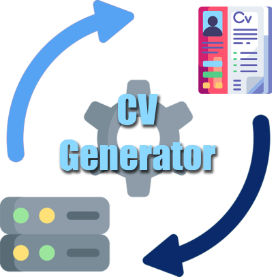

  

<h1 align="center">CV-Generator</h1>

  Des candidatures adaptées aux offres de l’OPT, avec une IA exécutée localement.

  
  
  

  <a href="#fonctionnalités">Fonctionnalités</a> ·
  <a href="#installation-et-documentation">Installation</a> ·
  <a href="#architecture">Architecture</a> ·
  <a href="https://github.com/gass-an/CV-Generator/releases">Versions</a>

---

CV-Generator génère des **CV**, des **lettres de motivation** et des
**guides de préparation à l’entretien** adaptés à un avis de vacance de
poste (AVP) de l’OPT, à partir des informations fournies dans un
**JSON Resume**.

Le modèle de langage est exécuté localement avec **llama.cpp**.

<!-- Décommenter lorsque le GIF sera disponible :

  

-->

## Fonctionnalités

- **Trois types de documents** : CV, lettre de motivation et préparation à l’entretien.
- **Candidatures ciblées** : génération à partir du profil JSON Resume et de l’AVP sélectionné.
- **Aperçu intégré** : consultation du PDF avant téléchargement.
- **Quatre formats d’export** : PDF, DOCX, AsciiDoc et Markdown.
- **Historique des générations** : consultation des documents et filtrage par AVP.
- **Administration privée** : gestion des clés API et suivi de l’activité.

## Installation et documentation

| Guide | Contenu |
| --- | --- |
| [Déploiement Docker](deploy/README.md) | Installation de production et configurations Docker |
| [Backend et API](generator-service/README.md) | Installation du backend et utilisation de l’API |
| [Exemples curl](generator-service/demo/curl-examples.md) | Tester les trois types de documents |
| [Composants partagés](shared/README.md) | Modèles communs et gestion métier des clés |
| [Publication des versions](RELEASING.md) | Procédure de version, publication et déploiement manuel |

## Architecture

| Composant | Rôle |
| --- | --- |
| `generatorweb-service/` | Interface utilisateur React |
| `generator-service/` | API FastAPI et worker de génération |
| `generator-admin-service/` | Service privé d’administration |
| `shared/` | Modèles et gestion des clés communs aux services Python |
| `deploy/` | Configurations Docker locales et de production |

Chaque demande est enregistrée comme un **job PostgreSQL**. Le worker
appelle ensuite **llama.cpp** et stocke le document source en **AsciiDoc**.
Les documents sont accessibles depuis l’interface et téléchargeables
dans les différents formats proposés.

En production, **Nginx** sert le frontend sur le port loopback configurable
`WEB_PORT` (`8082` par défaut). Il transmet également les requêtes
`/api/v1` à FastAPI sur le réseau Docker : le navigateur ne connaît
aucune adresse interne.

## Validation sélective

Le workflow principal détecte les chemins modifiés pour lancer les suites
Shared, backend, administration, frontend et Docker nécessaires.

Une modification de `shared/` teste également les deux services Python
qui en dépendent. Un lancement manuel ou une modification des workflows
exécute la validation complète.

Le job final **Résultat de la validation** reste toujours présent,
y compris pour un changement documentaire seul.

## Publication des versions

Les versions publiées sont disponibles dans les
[releases GitHub](https://github.com/gass-an/CV-Generator/releases).

La procédure de version, de publication et de déploiement manuel est
décrite dans [RELEASING.md](RELEASING.md), qui constitue la source de vérité.